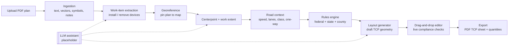

# TCP-Auto: Project Plan

Automated **Traffic Control Plan (TCP)** drafting from electrical/utility design plans.

> **Status:** Planning. Nothing here is implemented yet.
> **Safety note:** TCP-Auto produces *drafts*. Every plan must be reviewed, adjusted, and
> approved (and stamped where required) by a qualified person, such as a PE or a
> state-certified TCP/work-zone designer, before it is submitted or used in the field.

---

## 1. Goals

1. **Ingest** electrical design plans (mostly PDF, sometimes with handwritten or typed notes)
   that mark grid devices as **install/construct** or **remove**.
2. **Find the work location**: the centerpoint and extent of the work, placed on the real road network.
3. **Generate a draft TCP** that follows the federal MUTCD baseline plus **state and county/city rules**:
   signs, channelizing devices (cones/drums/barricades), tapers, buffers, flaggers,
   **police officers where required**, and reduced-speed / slow-down zones.
4. **Make the work zone at least 250 ft long** (`MIN_WORK_AREA_FT = 250`, configurable),
   enough room for two large utility trucks (e.g., bucket truck and digger derrick) plus working clearance.
5. **Let engineers and construction consultants edit** the draft in a drag-and-drop editor
   that checks compliance as they work.
6. **Export** a submittal-ready TCP sheet (PDF) with legend, device quantities, and notes.

**Design principle:** deterministic software does the work wherever possible. An **LLM is an
optional, pluggable assistant** (placeholder at first) for the fuzzy parts: reading notes,
resolving ambiguous symbols, picking the centerpoint, and sanity-checking the layout. Every LLM
output comes with a confidence score and a rationale, and a human confirms it before it is used.

### Non-goals (for v1)
- Replacing the engineer of record or automating permit submission.
- Long-term or complex staging (multi-phase detours, full road closures with detour routing). Leave hooks for these.
- Fully automatic handling of scanned raster plans. These get OCR plus a manual-assist path.

---

## 2. End-to-end workflow



Each stage writes a versioned, inspectable artifact (JSON). That makes any stage re-runnable,
lets the UI show what was inferred, and lets the user override it.

---

## 3. Stage details

### 3.1 Ingestion (PDF → structured page model)

Most utility plans are **vector PDFs exported from CAD** (AutoCAD, MicroStation). These carry
far more information than a scan.

| Input type | Approach |
|---|---|
| Vector PDF (preferred) | **PyMuPDF** to extract text spans with coordinates, vector paths (lines, polylines, circles, hatches), layers/OCGs where present, and embedded blocks |
| Raster / scanned PDF | Render pages, then **Tesseract OCR** for text. Symbol detection starts manual or LLM-vision assisted, with a trained detector later |
| Notes | Classify text blocks as **general notes**, **callouts/leaders**, **title block**, or **legend**. Keep the raw text for the LLM and rules |

Outputs (`PageModel`):
- Text spans (text, bbox, font, size, rotation)
- Vector primitives (type, geometry, stroke/fill, layer)
- Detected **scale** (parse `1" = 40'`, `SCALE: 1:480`, or a graphic scale bar)
- North arrow orientation (if detectable)
- Title block fields (job #, address, circuit, sheet #)
- Legend entries (symbol ↔ meaning)

### 3.2 Work-item extraction

Goal: a list of `WorkItem { kind, action, location_on_sheet, label, source_refs }`.

- **Device kinds**: pole, transformer (pole-mount/pad-mount), switch, recloser, capacitor bank, streetlight, guy/anchor, conductor span, vault/handhole, riser.
- **Action**: `install`, `remove`, `replace`, `transfer`, `existing` (context only).

Heuristics, applied in order, configurable per utility:
1. **Legend-driven matching**: parse the sheet legend, then match symbols by shape, line style, and layer.
2. **Text tags** near symbols: `INSTALL`, `REMOVE`, `PROP.`, `EXIST.`, `(R)`, `(N)`, `RMV`, `INST`, `RELOCATE`.
3. **Line style conventions**: e.g., solid/bold = proposed, dashed/light = existing, X-hatch = remove.
4. **Layer names** in CAD PDFs: e.g., `E-PROP-POLE`, `E-REMOVE`.
5. **Utility profile**: a per-customer YAML that maps that utility's symbology and keywords.

Items with low confidence get flagged for the **LLM assistant** (placeholder) and then for user confirmation.

### 3.3 Georeferencing

Plans have to be tied to real-world coordinates so we can look up the road and place devices on it.

Options, in priority order:
1. **Embedded geo data** (GeoPDF / coordinates in the title block or grid ticks).
2. **Address / intersection geocoding** from the title block and street labels, plus the sheet scale and north arrow.
3. **Manual pinning (always available)**: the user drops 2–3 control points (e.g., "this pole = this spot on the map"). Compute a similarity/affine transform.

Output: a transform `sheet_xy → lat/lon` with an error estimate.

### 3.4 Centerpoint and work extent

Deterministic baseline:
1. Take all `install`/`remove`/`replace` items that are **in or next to the roadway**. Items far behind the curb or in an easement get flagged as "may not need a TCP".
2. Project them onto the nearest **road centerline** (linear referencing).
3. Work extent = `[min_station, max_station]` of the projected items, plus truck clearance.
4. **Work area length = max(MIN_WORK_AREA_FT (250), extent + clearance)**, centered on the item cluster.
5. Lateral position: shoulder, parking lane, travel lane(s), center/turn lane, or intersection.
6. If items fall on several streets or an intersection, split into **multiple work zones** or pick an intersection template.

**LLM hook:** `propose_centerpoint()` gets the page model, the work items, notes (e.g., "trucks to set up on north side"), and road context. It returns a proposed centerpoint, side of road, and rationale. The software validates the proposal (on-road, within the extent) before showing it as a suggestion.

### 3.5 Road context

Use **OpenStreetMap** (Overpass API / osmnx) by default, with optional state DOT GIS layers:
- Posted speed limit (`maxspeed`). If missing, fall back to user input or a default by road class.
- Number of lanes, lane width, one-way, median/divided.
- Road classification (local / collector / arterial / highway), urban vs rural.
- Nearby intersections, driveways, crosswalks, bike lanes, sidewalks (pedestrian accommodation).
- **Optional:** AADT/traffic volume from the state DOT. This drives flagger, police, and work-hour rules.

Every value shows in the UI with its source and can be overridden. **Speed is the single most
important input**, so the user always confirms it.

### 3.6 Rules engine (federal → state → county/city)

Rules are **data, not code**. They live in versioned YAML files layered by jurisdiction:

```
rules/
  federal/mutcd-11th-ed.yaml        # baseline (FHWA MUTCD Part 6, Temporary Traffic Control)
  states/TX.yaml                    # e.g., Texas MUTCD differences, TxDOT standards
  states/CA.yaml
  counties/TX/travis.yaml           # local ROW permit / police / hours rules
  cities/TX/austin.yaml
  utilities/<utility>.yaml          # symbology + company safety policy (can be stricter)
```

Resolution: `federal ← state ← county ← city ← utility/company policy`. More specific layers
override or add constraints. The **strictest value wins** for safety minimums. Every computed
value keeps a **citation** (which file, which section) so reviewers can trace it.

**Baseline values to encode** (from MUTCD Part 6. Verify against the edition each state has
adopted, because the 11th Edition, 2023, renumbered some tables and typical applications):

| Quantity | Rule (baseline) |
|---|---|
| Merging taper length **L** | `L = W·S²/60` for S ≤ 40 mph; `L = W·S` for S ≥ 45 mph (W = offset ft, S = speed mph) |
| Shifting taper | ≥ 0.5 L |
| Shoulder taper | ≥ 0.33 L |
| One-lane two-way (flagger) taper | 50 ft min, 100 ft max |
| Downstream taper | 50–100 ft (per lane) |
| Device spacing | ≤ 1.0 × S (ft) in tapers, ≤ 2.0 × S (ft) along tangents |
| Advance warning sign spacing (A/B/C) | Urban low-speed ≈ 100 ft; urban high-speed ≈ 350 ft; rural ≈ 500 ft; expressway/freeway ≈ 1000/1500/2640 ft (the agency sets the speed category) |
| Longitudinal buffer / flagger stopping distance | 20 mph: 115 ft · 25: 155 · 30: 200 · 35: 250 · 40: 305 · 45: 360 · 50: 425 · 55: 495 · 60: 570 · 65: 645 · 70: 730 |

**Typical application selection:** a decision table keyed on *(road type, lanes, divided?, speed,
work position, duration, volume)* picks a template. Examples, by 2009 numbering: TA-3 shoulder work,
TA-6 shoulder work with minor encroachment, TA-10 lane closure on a two-lane road with flaggers,
TA-22 lane closure near an intersection, TA-33 stationary lane closure on a divided highway.

**Jurisdiction-specific rules** (examples of what the YAML must be able to express):
- **Police detail / law enforcement required** when, for example: road class ≥ arterial, speed ≥ X mph,
  signalized intersection inside the zone, lane closure on a state route, or certain volumes or hours.
  Many cities and counties make this a permit condition.
- Allowed **work hours** and lane-closure windows (peak-hour restrictions).
- **Reduced speed zone** rules: when a work-zone speed limit may be posted, by how much,
  sign types (e.g., `R2-1` speed limit, `W3-5` reduced speed ahead), fines-doubled signage.
- Required certifications (flagger, TCP designer), permit types, submittal format.
- Pedestrian/ADA accommodation (sidewalk closures, detours, detectable barricades).
- Stricter local minimums (e.g., buffer length, sign size, required arrow board).

Example rule snippet:

```yaml
jurisdiction: { level: county, state: TX, name: Travis }
extends: states/TX.yaml
rules:
  police_required:
    any:
      - road_class: [arterial, highway]
      - speed_mph: { gte: 45 }
      - signalized_intersection_in_zone: true
    citation: "Travis Co. ROW Permit Conditions §4.2 (placeholder)"
  work_hours:
    lane_closure_allowed: ["09:00-15:30"]
    citation: "placeholder"
  min_work_area_ft: 250
```

> Real jurisdiction files must be written from the actual adopted documents. The values above
> are placeholders. This repo should ship **federal baseline + one pilot state/county** first.

### 3.7 Layout generator

Input: road centerline geometry, work zone (stations + lateral position), resolved rules, chosen template.
Output: a `TcpPlan`, a list of placed `Device`s with geometry along the road.

Algorithm (linear-referenced along the centerline, per approach direction):
1. Place the **work area** (≥ 250 ft) and the **truck footprints** (e.g., 2 × ~40 ft trucks with spacing).
2. Add the **buffer space** upstream (from the speed table).
3. Add the **transition taper** (length from the formula and template), then place channelizing devices at the computed spacing.
4. Add the **advance warning area**: sign sequence at A/B/C spacing (e.g., `W20-1` Road Work Ahead → `W20-5` Lane Closed Ahead → `W4-2` Lane Ends / `W20-7` Flagger).
5. Add the **termination area**: downstream taper plus `G20-2` End Road Work.
6. Add **flagger stations** or **police officer positions** if the rules require them.
7. Add a **reduced-speed zone** (start/end signs) if allowed and warranted.
8. Repeat for the opposing direction, side streets, and driveways inside the zone.
9. Run the **compliance checker** (same code the editor uses) and attach any warnings.

Everything placed is tagged `generated` with the rule that produced it. User edits are tagged `manual`.

### 3.8 Drag-and-drop editor

Web app with **two synchronized views**:
- **Map view** (MapLibre GL on a street basemap or aerial): the georeferenced TCP on real roads.
- **Sheet view**: the original PDF page with the work items highlighted, for cross-checking.

Editor features:
- **Device palette** (MUTCD sign codes with icons, cones, drums, Type I/II/III barricades,
  arrow board, PCMS, flagger, police officer, truck, work area polygon).
- Drag, rotate, delete, multi-select, align, **snap to road edge/lane line/centerline**.
- **Taper and line tools**: draw a taper and devices auto-space along it at the rule spacing.
- **Live compliance panel**: e.g., "Taper is 180 ft, needs ≥ 245 ft at 35 mph" or
  "Sign B spacing 220 ft < 350 ft". Click a warning to jump to the device.
- Edit road context (speed, lanes) and regenerate, keeping manual edits where possible.
- Undo/redo, version history, comments, and a reviewer sign-off state (`draft → in review → approved`).
- Quantity table that updates live (counts of signs, cones, barricades, flaggers, officers).

### 3.9 Export
- **PDF TCP sheet**: plan view, legend, device quantity table, general notes (from rules plus the
  user), title block, north arrow, scale, typical application reference, and signature/stamp block.
- JSON (round-trip) and GeoJSON. DXF export later for CAD users.

---

## 4. LLM assistant (placeholder design)

A single provider-agnostic interface. v1 ships a `NullAssistant` that returns "no suggestion", so
the whole pipeline runs **without** an LLM.

```python
class PlanAssistant(Protocol):
    def classify_work_items(self, page: PageModel, candidates: list[WorkItem]) -> list[Suggestion[WorkItem]]: ...
    def interpret_notes(self, notes: list[TextBlock]) -> list[Suggestion[Constraint]]: ...
    def propose_centerpoint(self, ctx: SiteContext) -> Suggestion[WorkZoneProposal]: ...
    def review_layout(self, plan: TcpPlan, rules: ResolvedRules) -> list[Suggestion[ReviewComment]]: ...

@dataclass
class Suggestion(Generic[T]):
    value: T
    confidence: float      # 0..1
    rationale: str         # shown to the user
    source: str            # "heuristic" | "llm:<provider>" | "user"
```

Rules for the LLM:
- **Structured output only** (JSON schema / tool calling). Never free text into geometry.
- Inputs: rendered page image crops (vision) plus extracted text and coordinates, never the whole raw PDF.
- Outputs are **validated by software** (on-road, inside the sheet bounds, a valid device kind) before display.
- The LLM **never** overrides a rule minimum. It can only propose things inside the rule constraints.
- Log prompts and responses per job for audit.
- Candidate provider: a vision-capable model with tool use (e.g., Claude via the Anthropic API),
  kept behind the interface so it can be swapped or self-hosted.

---

## 5. Proposed architecture and tech stack

| Layer | Choice | Why |
|---|---|---|
| Backend API | **Python 3.12 + FastAPI** | Best PDF/geo ecosystem |
| PDF | **PyMuPDF**, pdfplumber (fallback), Tesseract (OCR) | Vector + text extraction |
| Geometry | **Shapely**, **pyproj**, osmnx / Overpass | Linear referencing, projections, road data |
| Rules | YAML + Pydantic models + small expression evaluator | Auditable, editable without code changes |
| Jobs | Background worker (RQ/Celery or FastAPI BackgroundTasks to start) | PDF processing can be slow |
| Database | **PostgreSQL + PostGIS** (SQLite for local dev) | Spatial queries, versioning |
| File storage | Local disk → S3-compatible | Uploaded PDFs, exports |
| Frontend | **React + TypeScript + Vite**, **MapLibre GL JS**, dnd-kit for palette | Drag-and-drop on a real map |
| PDF export | ReportLab or headless browser (Playwright) print | Submittal-quality sheets |
| Testing | pytest (golden-file tests per sample plan), Vitest, Playwright E2E | Regressions in geometry are subtle |

Proposed repo layout:

```
tcp-auto/
  backend/
    tcp_auto/
      ingest/        # PDF → PageModel
      extract/       # PageModel → WorkItems
      georef/        # sheet ↔ world transforms
      site/          # centerpoint, work extent, road context
      rules/         # loader, resolver, evaluator, citations
      layout/        # template selection + device placement
      compliance/    # checks shared by generator and editor
      assistant/     # PlanAssistant interface, NullAssistant, providers
      export/        # PDF/GeoJSON
      api/           # FastAPI routes
    tests/
  frontend/          # React editor
  rules/             # jurisdiction YAML (federal, states, counties, cities, utilities)
  samples/           # sample plans (sanitized) + expected outputs
  docs/
```

### Core data model (simplified)
- `Project` → `PlanDocument` (PDF, pages) → `WorkItem[]`
- `WorkZone { centerline_ref, start_station, end_station, side, lanes_affected, length_ft ≥ 250 }`
- `RoadContext { speed_mph, lanes, class, divided, one_way, urban, sources{} }`
- `ResolvedRules { values{}, citations{}, jurisdiction_chain[] }`
- `TcpPlan { version, template_id, devices[], warnings[], status }`
- `Device { id, type, mutcd_code?, geometry, rotation, direction, origin: generated|manual, rule_ref? }`

---

## 6. Phased roadmap

| Phase | Deliverable | Exit criteria |
|---|---|---|
| **0. Foundation** | Repo scaffolding, CI, data models, sample plan collection | 5–10 real (sanitized) plans with hand-made reference TCPs |
| **1. Ingestion MVP** | Vector PDF → PageModel, scale detection, keyword-based install/remove extraction, utility profile YAML | ≥ 90% of work items found on sample vector plans |
| **2. Georef + site** | Manual 2-point pinning, OSM road lookup, centerpoint/extent, 250 ft minimum | Centerpoint within ~25 ft of the reference on samples |
| **3. Rules engine** | Federal baseline + 1 pilot state + 1 pilot county, citations, police/flagger/speed rules | Unit tests reproduce MUTCD tables and formulas |
| **4. Layout generator** | 4–5 typical applications (shoulder, 2-lane flagger, multilane lane closure, intersection) | Generated drafts pass compliance checks and match reference layouts |
| **5. Editor** | Map editor, palette, snapping, live compliance, versions | Consultant can fix a draft in < 15 min |
| **6. Export** | PDF TCP sheet + quantities | Accepted by pilot agency/reviewer as submittal format |
| **7. LLM integration** | Real provider behind `PlanAssistant` for notes, ambiguous symbols, centerpoint, review | Measurable lift over heuristics on samples, with human confirmation |
| **8. Scale-out** | More jurisdictions, raster/OCR improvements, multi-zone/detours, DXF | Driven by customer demand |

**Suggested first build slice (vertical):** one vector PDF → manual pin → OSM speed/lanes →
federal rules → TA-10 (two-lane, flagger) layout → shown read-only on a map. Then add editing.

---

## 7. Risks and mitigations

| Risk | Mitigation |
|---|---|
| Symbology differs by utility/engineer | Per-utility profile YAML; legend parsing; LLM fallback; user confirmation |
| Wrong speed or lane data from OSM | Always show the source; require the user to confirm speed; allow overrides |
| Legal liability for non-compliant plans | Draft-only status, mandatory reviewer sign-off, citations on every value, audit log |
| Local rules are scattered and change often | Rules as versioned data with effective dates; per-jurisdiction owners; start with pilot jurisdictions |
| Scanned/low-quality PDFs | OCR + manual-assist workflow; never block, fall back to manual |
| LLM hallucination | Structured outputs, software validation, can't override minimums, human-in-the-loop |

---

## 8. Open questions for you

1. **Pilot jurisdiction(s):** which state(s) and county/city should we encode first?
2. **Sample plans:** can you provide a few real PDFs (sanitized) and, ideally, the TCPs that were actually approved for them?
3. **Symbology:** do the plans come from one utility/engineering firm (one legend) or many?
4. **Submittal format:** does the agency require a specific sheet size, title block, or TCP template?
5. **Who uses it:** internal engineers only, or outside consultants too (auth, multi-tenant, roles)?
6. **Deployment:** hosted web app, on-prem, or desktop?
7. **Work types beyond lane closures:** intersections, sidewalk closures, night work, road closures with detours?
8. **Police details:** are you aware of specific thresholds in your target areas, and should the app produce the police request paperwork?
