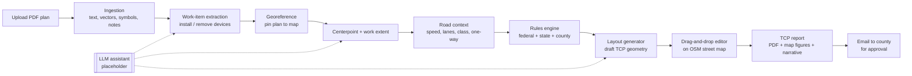

# TCP-Auto: Project Plan

Automated **Traffic Control Plan (TCP)** drafting from electrical/utility design plans.

> **Status:** Planning. Nothing here is implemented yet.
> **Safety note:** TCP-Auto produces *drafts*. Every plan must be reviewed, adjusted, and
> approved (and stamped where required) by a qualified person, such as a PE or a
> state-certified TCP/work-zone designer, before it is submitted or used in the field.

---

## 1. Goals

1. **Ingest** electrical design plans (mostly PDF, sometimes with handwritten or typed notes)
   that mark grid devices as **install/construct** or **remove**.
2. **Find the work location**: the centerpoint and extent of the work, placed on the real road network.
3. **Generate a draft TCP** that follows the federal MUTCD baseline plus **state and county/city rules**:
   signs, channelizing devices (cones/drums/barricades), tapers, buffers, flaggers,
   **police officers where required**, and reduced-speed / slow-down zones.
4. **Make the work zone at least 250 ft long** (`MIN_WORK_AREA_FT = 250`, configurable),
   enough room for two large utility trucks (e.g., bucket truck and digger derrick) plus working clearance.
5. **Let engineers and construction consultants edit** the draft in a drag-and-drop editor
   that checks compliance as they work.
6. **Export a standalone TCP report** (PDF) that can be emailed straight to a county or city for
   approval. It includes map figures drawn on an OpenStreetMap basemap, a plain-language narrative
   explaining the plan, a sign and device legend, quantities, and rule citations.

**The TCP is its own deliverable.** It is **not** drawn onto the electrical design sheets. The
design PDF is only an *input* that tells the app where the work is and what is being done. All
TCP drawings are generated fresh on a real street map.

### Project context (confirmed)
- **Organization:** an electrical utility company (one organization plus outside consultants).
- **Pilot area:** **Arizona: Maricopa County and Pinal County** (see §3.6.1).
- **Users:** designers, engineers, inspectors, schedulers, and construction consultants (see §3.10).
- **Report:** no county-mandated format. Must include a **map highlighting the main elements**,
  a **brief explanation**, and a **timeline** (see §3.9).
- **Missing information** on drawings (dates, hours, speed, contacts, etc.) is entered by the user (see §3.2.1).
- **Deployment:** hosted web app (see §5.1).

**Design principle:** deterministic software does the work wherever possible. An **LLM is an
optional, pluggable assistant** (placeholder at first) for the fuzzy parts: reading notes,
resolving ambiguous symbols, picking the centerpoint, and sanity-checking the layout. Every LLM
output comes with a confidence score and a rationale, and a human confirms it before it is used.

### Non-goals (for v1)
- Replacing the engineer of record or automating permit submission.
- Long-term or complex staging (multi-phase detours, full road closures with detour routing). Leave hooks for these.
- Fully automatic handling of scanned raster plans. These get OCR plus a manual-assist path.

---

## 2. End-to-end workflow



Each stage writes a versioned, inspectable artifact (JSON). That makes any stage re-runnable,
lets the UI show what was inferred, and lets the user override it.

---

## 3. Stage details

### 3.1 Ingestion (PDF → structured page model)

Most utility plans are **vector PDFs exported from CAD** (AutoCAD, MicroStation). These carry
far more information than a scan.

| Input type | Approach |
|---|---|
| Vector PDF (preferred) | **PyMuPDF** to extract text spans with coordinates, vector paths (lines, polylines, circles, hatches), layers/OCGs where present, and embedded blocks |
| Raster / scanned PDF | Render pages, then **Tesseract OCR** for text. Symbol detection starts manual or LLM-vision assisted, with a trained detector later |
| Notes | Classify text blocks as **general notes**, **callouts/leaders**, **title block**, or **legend**. Keep the raw text for the LLM and rules |

Outputs (`PageModel`):
- Text spans (text, bbox, font, size, rotation)
- Vector primitives (type, geometry, stroke/fill, layer)
- Detected **scale** (parse `1" = 40'`, `SCALE: 1:480`, or a graphic scale bar)
- North arrow orientation (if detectable)
- Title block fields (job #, address, circuit, sheet #)
- Legend entries (symbol ↔ meaning)

### 3.2 Work-item extraction

Goal: a list of `WorkItem { kind, action, location_on_sheet, label, source_refs }`.

- **Device kinds**: pole, transformer (pole-mount/pad-mount), switch, recloser, capacitor bank, streetlight, guy/anchor, conductor span, vault/handhole, riser.
- **Action**: `install`, `remove`, `replace`, `transfer`, `existing` (context only).

Heuristics, applied in order, configurable per utility:
1. **Legend-driven matching**: parse the sheet legend, then match symbols by shape, line style, and layer.
2. **Text tags** near symbols: `INSTALL`, `REMOVE`, `PROP.`, `EXIST.`, `(R)`, `(N)`, `RMV`, `INST`, `RELOCATE`.
3. **Line style conventions**: e.g., solid/bold = proposed, dashed/light = existing, X-hatch = remove.
4. **Layer names** in CAD PDFs: e.g., `E-PROP-POLE`, `E-REMOVE`.
5. **Utility profile**: a per-customer YAML that maps that utility's symbology and keywords.

Items with low confidence get flagged for the **LLM assistant** (placeholder) and then for user confirmation.

### 3.2.1 Project details form (user input fills the gaps)

Many drawings won't contain everything the TCP and report need. Each project has a **project
details form**. Fields are pre-filled from the drawing when the app can find them, and the user
enters or corrects the rest. Every field shows a source badge: `from drawing`, `from map (OSM)`,
`rule default`, or `entered by <user>`.

| Group | Fields |
|---|---|
| Job | Work order / job #, permit #, project name, utility circuit/feeder, description of work (e.g., "Replace 2 poles and transfer conductors") |
| Location | Address or intersection, city/unincorporated area (auto-detected, see §3.6.1), side of road, map pin |
| Road | Posted speed (**must be confirmed**), lanes, divided/undivided, one-way, bike lane, sidewalk, nearby signals |
| Equipment | Number and type of trucks (default: 2 large trucks), need for crane/digger, material staging |
| Timeline | Start date, end date or duration, daily work hours, days of week, night work?, phases (see §3.9) |
| Traffic control | Flaggers (count), police officer requested/required, reduced speed requested, pedestrian detour needed |
| Contacts | Designer/preparer, field supervisor, 24-hour emergency contact, traffic control contractor |

Required fields are checked before a report can be generated. Missing values are listed clearly,
for example "Posted speed not confirmed".

### 3.3 Locating the work on the map

Because the TCP is drawn on a street map and not on the design sheet, we don't need a precise
sheet-to-world overlay. We only need **where the work is** (street, block, side of road) and
**how long a stretch it covers**.

Options, in priority order:
1. **Embedded geo data** (GeoPDF / coordinates in the title block or grid ticks).
2. **Address / intersection geocoding** from the title block and street labels (e.g., "1200 Main St"
   or "Main St & 5th Ave"), using Nominatim or another geocoder. Sheet scale + north arrow give the
   work extent in feet.
3. **Manual pin (always available)**: the user drops a pin on the map where the work is and drags
   the work-zone ends. Optionally add 2–3 control points (e.g., "this pole = this spot") if they
   want the device positions carried over more precisely.

Output: a work location (lat/lon + road segment) and an extent, each with a confidence estimate.

### 3.4 Centerpoint and work extent

Deterministic baseline:
1. Take all `install`/`remove`/`replace` items that are **in or next to the roadway**. Items far behind the curb or in an easement get flagged as "may not need a TCP".
2. Project them onto the nearest **road centerline** (linear referencing).
3. Work extent = `[min_station, max_station]` of the projected items, plus truck clearance.
4. **Work area length = max(MIN_WORK_AREA_FT (250), extent + clearance)**, centered on the item cluster.
5. Lateral position: shoulder, parking lane, travel lane(s), center/turn lane, or intersection.
6. If items fall on several streets or an intersection, split into **multiple work zones** or pick an intersection template.

**LLM hook:** `propose_centerpoint()` gets the page model, the work items, notes (e.g., "trucks to set up on north side"), and road context. It returns a proposed centerpoint, side of road, and rationale. The software validates the proposal (on-road, within the extent) before showing it as a suggestion.

### 3.5 Road context

Use **OpenStreetMap** (Overpass API / osmnx) by default, with optional state DOT GIS layers:
- Posted speed limit (`maxspeed`). If missing, fall back to user input or a default by road class.
- Number of lanes, lane width, one-way, median/divided.
- Road classification (local / collector / arterial / highway), urban vs rural.
- Nearby intersections, driveways, crosswalks, bike lanes, sidewalks (pedestrian accommodation).
- **Optional:** AADT/traffic volume from the state DOT. This drives flagger, police, and work-hour rules.

Every value shows in the UI with its source and can be overridden. **Speed is the single most
important input**, so the user always confirms it.

### 3.6 Rules engine (federal → state → county/city)

Rules are **data, not code**. They live in versioned YAML files layered by jurisdiction:

```
rules/
  federal/mutcd.yaml                # baseline (FHWA MUTCD Part 6, Temporary Traffic Control)
  states/AZ.yaml                    # Arizona Supplement differences
  states/AZ-adot.yaml               # ADOT rules for state routes
  counties/AZ/maricopa.yaml         # MCDOT permit / police / hours rules
  counties/AZ/pinal.yaml            # Pinal County Public Works rules
  cities/AZ/phoenix.yaml            # city barricade manual / permit conditions
  cities/AZ/mesa.yaml               # ...one file per city as they are added
  utilities/<utility>.yaml          # symbology + company safety policy (can be stricter)
```

Resolution: `federal ← state ← county ← city ← utility/company policy`. More specific layers
override or add constraints. The **strictest value wins** for safety minimums. Every computed
value keeps a **citation** (which file, which section) so reviewers can trace it.

**Baseline values to encode** (from MUTCD Part 6. Verify against the edition each state has
adopted, because the 11th Edition, 2023, renumbered some tables and typical applications):

| Quantity | Rule (baseline) |
|---|---|
| Merging taper length **L** | `L = W·S²/60` for S ≤ 40 mph; `L = W·S` for S ≥ 45 mph (W = offset ft, S = speed mph) |
| Shifting taper | ≥ 0.5 L |
| Shoulder taper | ≥ 0.33 L |
| One-lane two-way (flagger) taper | 50 ft min, 100 ft max |
| Downstream taper | 50–100 ft (per lane) |
| Device spacing | ≤ 1.0 × S (ft) in tapers, ≤ 2.0 × S (ft) along tangents |
| Advance warning sign spacing (A/B/C) | Urban low-speed ≈ 100 ft; urban high-speed ≈ 350 ft; rural ≈ 500 ft; expressway/freeway ≈ 1000/1500/2640 ft (the agency sets the speed category) |
| Longitudinal buffer / flagger stopping distance | 20 mph: 115 ft · 25: 155 · 30: 200 · 35: 250 · 40: 305 · 45: 360 · 50: 425 · 55: 495 · 60: 570 · 65: 645 · 70: 730 |

**Typical application selection:** a decision table keyed on *(road type, lanes, divided?, speed,
work position, duration, volume)* picks a template. Examples, by 2009 numbering: TA-3 shoulder work,
TA-6 shoulder work with minor encroachment, TA-10 lane closure on a two-lane road with flaggers,
TA-22 lane closure near an intersection, TA-33 stationary lane closure on a divided highway.

**Jurisdiction-specific rules** (examples of what the YAML must be able to express):
- **Police detail / law enforcement required** when, for example: road class ≥ arterial, speed ≥ X mph,
  signalized intersection inside the zone, lane closure on a state route, or certain volumes or hours.
  Many cities and counties make this a permit condition.
- Allowed **work hours** and lane-closure windows (peak-hour restrictions).
- **Reduced speed zone** rules: when a work-zone speed limit may be posted, by how much,
  sign types (e.g., `R2-1` speed limit, `W3-5` reduced speed ahead), fines-doubled signage.
- Required certifications (flagger, TCP designer), permit types, submittal format.
- Pedestrian/ADA accommodation (sidewalk closures, detours, detectable barricades).
- Stricter local minimums (e.g., buffer length, sign size, required arrow board).

Example rule snippet:

```yaml
jurisdiction: { level: county, state: AZ, name: Maricopa, agency: MCDOT }
extends: states/AZ.yaml
applies_to: { road_owner: county }        # unincorporated county roads only
submittal:
  method: email                           # or: portal
  recipient: "<permit office address>"    # placeholder
rules:
  police_required:
    any:
      - road_class: [arterial]
      - speed_mph: { gte: 45 }
      - signalized_intersection_in_zone: true
    citation: "PLACEHOLDER - verify against MCDOT permit conditions"
  work_hours:
    lane_closure_allowed: ["09:00-15:00"]  # placeholder
    citation: "PLACEHOLDER"
  min_work_area_ft: 250
```

> Real jurisdiction files must be written from the actual adopted documents. The values above
> are placeholders. This repo should ship **federal baseline + Arizona + Maricopa/Pinal** first.

#### 3.6.1 Pilot jurisdictions: Arizona, Maricopa County, Pinal County

**Which rules apply depends on who owns the road**, not just which county the work is in. Inside
Maricopa and Pinal counties there are three main road owners:

| Road owner | Examples | Rule chain |
|---|---|---|
| **ADOT** (state routes, interstates, US routes) | I-10, SR-87, SR-347, US-60 | Federal → Arizona → ADOT |
| **County** (unincorporated areas) | MCDOT roads; Pinal County roads in areas like San Tan Valley | Federal → Arizona → county |
| **City / town** (incorporated areas) | Phoenix, Mesa, Chandler, Gilbert, Scottsdale, Tempe, Glendale; Casa Grande, Maricopa, Florence, Apache Junction | Federal → Arizona → county (if it applies) → city |

The app resolves the owner automatically from GIS layers: city/town limits, ADOT route centerlines,
and county road inventories (most are published as open data). The user can override it. The
owner also decides **who receives the report** (which permit office to email).

Source documents to obtain and encode (verify the current edition and exact titles):
- **FHWA MUTCD** and the **Arizona Supplement**. Confirm which MUTCD edition ADOT currently adopts.
- **ADOT** traffic control design guidelines and standard traffic control drawings (for state routes and permits).
- **MAG** (Maricopa Association of Governments) Uniform Standard Specifications and Details, used by many Maricopa cities.
- **MCDOT** right-of-way permit and traffic control requirements (unincorporated Maricopa County).
- **Pinal County Public Works** right-of-way / encroachment permit requirements.
- **City barricade manuals and permit conditions**, starting with the cities where the utility
  works most (e.g., the City of Phoenix traffic barricade manual).

Arizona-specific rule topics to capture:
- Peak-hour lane-closure restrictions on arterials (common in metro Phoenix cities). Exact hours vary by agency.
- When **off-duty police officers** are required (e.g., signalized intersections, arterials, high speed).
  This varies by city and must come from each agency's documents.
- Work in or near **signalized intersections**, which often needs separate signal or traffic engineering approval.
- Pedestrian/ADA accommodation where sidewalks are closed.
- Report delivery: permit office email or permit portal per agency (stored in the jurisdiction file).

**Pilot order (suggested):** (1) unincorporated Maricopa and Pinal county roads, (2) the 2–3 cities
with the most utility work, (3) ADOT state routes, (4) the remaining cities.

### 3.7 Layout generator

Input: road centerline geometry, work zone (stations + lateral position), resolved rules, chosen template.
Output: a `TcpPlan`, a list of placed `Device`s with geometry along the road.

Algorithm (linear-referenced along the centerline, per approach direction):
1. Place the **work area** (≥ 250 ft) and the **truck footprints** (e.g., 2 × ~40 ft trucks with spacing).
2. Add the **buffer space** upstream (from the speed table).
3. Add the **transition taper** (length from the formula and template), then place channelizing devices at the computed spacing.
4. Add the **advance warning area**: sign sequence at A/B/C spacing (e.g., `W20-1` Road Work Ahead → `W20-5` Lane Closed Ahead → `W4-2` Lane Ends / `W20-7` Flagger).
5. Add the **termination area**: downstream taper plus `G20-2` End Road Work.
6. Add **flagger stations** or **police officer positions** if the rules require them.
7. Add a **reduced-speed zone** (start/end signs) if allowed and warranted.
8. Repeat for the opposing direction, side streets, and driveways inside the zone.
9. Run the **compliance checker** (same code the editor uses) and attach any warnings.

Everything placed is tagged `generated` with the rule that produced it. User edits are tagged `manual`.

### 3.8 Drag-and-drop editor

Web app built around a **map view**: MapLibre GL on an OpenStreetMap-based street basemap (with an
optional aerial layer where licensing allows). The TCP is drawn and edited here, on real roads.
A collapsible **reference panel** shows the original design PDF with the work items highlighted,
for cross-checking only. Nothing is drawn on the design sheet.

Editor features:
- **Device palette** (MUTCD sign codes with icons, cones, drums, Type I/II/III barricades,
  arrow board, PCMS, flagger, police officer, truck, work area polygon).
- Drag, rotate, delete, multi-select, align, **snap to road edge/lane line/centerline**.
- **Taper and line tools**: draw a taper and devices auto-space along it at the rule spacing.
- **Live compliance panel**: e.g., "Taper is 180 ft, needs ≥ 245 ft at 35 mph" or
  "Sign B spacing 220 ft < 350 ft". Click a warning to jump to the device.
- Edit road context (speed, lanes) and regenerate, keeping manual edits where possible.
- Undo/redo, version history, comments, and a reviewer sign-off state (`draft → in review → approved`).
- Quantity table that updates live (counts of signs, cones, barricades, flaggers, officers).

### 3.9 TCP report (emailable approval package)

The main output is a **self-contained PDF report** that a county or city reviewer can open from an
email and understand without the app or the design plans. It both **illustrates** the plan (maps,
diagrams) and **explains** it (plain-language narrative).

Maricopa and Pinal don't require a specific format, so the default report is **short and
visual**: the core is a map, a brief explanation, and a timeline. Ideally that fits on 1–2 pages.
Supporting detail goes on optional appendix pages the user can switch on or off.

**Core report (always included)**

| # | Section | Contents |
|---|---|---|
| 1 | Header | Utility name/logo, project name, job/permit #, address, road owner (ADOT / county / city), prepared by, date, revision |
| 2 | **TCP map** (main figure) | Layout on the OSM street map, **highlighting the main elements** with clear colors and labels: work area (≥ 250 ft) and trucks, lane(s) closed, tapers, cones/barricades, advance warning signs, flagger and police positions, reduced-speed zone start/end. Includes cross-street names, north arrow, scale bar, compact legend, and key dimensions |
| 3 | **Brief explanation** | 1–2 generated paragraphs in plain language, e.g.: "Pacific Ave will have the northbound right lane closed for 300 ft between 4th St and 5th St to replace two utility poles. Traffic will merge left using a 245 ft cone taper. Two flaggers will control traffic, and a 35 mph reduced-speed zone will be posted. Sidewalk on the east side will remain open." |
| 4 | **Timeline** | Start/end dates, daily work hours, days of week, and a simple bar chart of the phases (see below). Flags any conflict with the agency's lane-closure hours |
| 5 | Contacts | Field supervisor, 24-hour emergency contact, preparer |

**Optional appendix pages (toggle per report)**
- Location/vicinity map (zoomed out).
- Detail maps per approach with dimension callouts.
- Sign sequence strip diagram (sign faces in order, with distances).
- Compliance table: required minimum vs. provided, with the source rule for each value.
- Device quantities (signs by code, cones/drums, barricades, arrow boards, PCMS, flaggers, officers).
- General notes from the rules plus project notes.
- Approval/signature block, and a county approval box.

**Timeline details**

The timeline comes from the project details form (§3.2.1), or from the schedule if a scheduler set one.

- Phases, default set: **mobilize & set up traffic control → work → remove traffic control & demobilize**.
  Users can add phases (e.g., "Day 1: set poles", "Day 2: transfer conductors") or a per-day breakdown.
- Each phase has dates, daily hours, which traffic control layout is active, and the flagger/police needs.
- Checks: lane closures outside allowed hours, weekend or holiday work, night work needing lighting.
- Shown as a simple bar chart in the report and an editable timeline in the app.
- Different layouts per phase are supported (e.g., shoulder closure on day 1, lane closure on day 2).

**How it's built**
- Map figures are rendered server-side from the same plan data the editor uses (MapLibre in a
  headless browser via Playwright, or a static map renderer), at print resolution, with the
  required "© OpenStreetMap contributors" attribution.
- The narrative is **generated from templates** using the plan data, so it is deterministic and
  always matches the drawing. The LLM can optionally polish the wording later but can't change facts.
- The report is laid out as HTML/CSS and printed to PDF (Playwright), which keeps styling easy and
  makes per-county templates simple. Letter or 11×17 page sizes.
- Keep file size **email-friendly** (target < 10 MB) with compressed map images.

**Sending it**
- "Email to county" action: pre-fills recipient (from the jurisdiction file), subject, and a short
  cover message, with the PDF attached. Start with a download + `mailto:` draft; add direct sending
  (SMTP or an email API) and delivery/approval tracking later.
- Optional attachments: KML/GeoJSON of the layout (reviewers can open it in Google Earth or GIS),
  and an editable DOCX version if a county asks for one.
- Status tracking per plan: `draft → in review → sent to county → approved / revisions requested`.

**Other exports:** JSON (round-trip), GeoJSON/KML, and DXF later for CAD users.

### 3.10 Users, roles, and workflow

One organization (the utility) with outside consultants invited per project.

| Role | Main tasks | Key permissions |
|---|---|---|
| **Designer** | Upload drawings, confirm work items, fill in project details, generate and edit the TCP | Create/edit projects and plans |
| **Engineer** | Review drafts, fix issues, approve/sign, maintain utility rule files | Edit, approve, manage rules |
| **Scheduler** | Set dates, hours, phases; coordinate flaggers/police; see the calendar across projects | Edit timeline; view plans |
| **Inspector** | Check the setup in the field against the plan; record photos, notes, and deviations | View plans (mobile); add field reports |
| **Construction consultant** (external) | Prepare or adjust TCPs for assigned projects | Edit/comment only on projects they're invited to |
| **Admin** | Users, roles, organization settings, jurisdiction contacts | Everything |

Plan status flow:
`draft → engineer review → approved internally → sent to agency → agency approved / revisions requested → active in field → closed`.
Every change is logged (who, what, when) for accountability.

**Scheduler view:** a calendar and list of upcoming work across all projects, with filters for
county/city, status, and flagger/police needs. It highlights conflicts such as two closures
on the same road on the same day, or work outside allowed hours.

**Inspector field mode (mobile-friendly):**
- Open the plan on a phone or tablet at the site, with GPS location shown on the map.
- A checklist generated from the plan (signs in place and spaced correctly, taper length, cones,
  flaggers, police present).
- Attach photos and notes. Mark deviations and send them back to the designer.
- Field reports are stored with the project and can be added to the record.

**Map data and tiles:** use OpenStreetMap data, but not the public `tile.openstreetmap.org` servers
for production (their usage policy forbids heavy use). Use a hosted OSM tile provider (e.g.,
MapTiler, Stadia, Thunderforest) or self-host vector tiles (e.g., Protomaps/PMTiles). Always show attribution.

---

## 4. LLM assistant (placeholder design)

A single provider-agnostic interface. v1 ships a `NullAssistant` that returns "no suggestion", so
the whole pipeline runs **without** an LLM.

```python
class PlanAssistant(Protocol):
    def classify_work_items(self, page: PageModel, candidates: list[WorkItem]) -> list[Suggestion[WorkItem]]: ...
    def interpret_notes(self, notes: list[TextBlock]) -> list[Suggestion[Constraint]]: ...
    def propose_centerpoint(self, ctx: SiteContext) -> Suggestion[WorkZoneProposal]: ...
    def review_layout(self, plan: TcpPlan, rules: ResolvedRules) -> list[Suggestion[ReviewComment]]: ...

@dataclass
class Suggestion(Generic[T]):
    value: T
    confidence: float      # 0..1
    rationale: str         # shown to the user
    source: str            # "heuristic" | "llm:<provider>" | "user"
```

Rules for the LLM:
- **Structured output only** (JSON schema / tool calling). Never free text into geometry.
- Inputs: rendered page image crops (vision) plus extracted text and coordinates, never the whole raw PDF.
- Outputs are **validated by software** (on-road, inside the sheet bounds, a valid device kind) before display.
- The LLM **never** overrides a rule minimum. It can only propose things inside the rule constraints.
- Log prompts and responses per job for audit.
- Candidate provider: a vision-capable model with tool use (e.g., Claude via the Anthropic API),
  kept behind the interface so it can be swapped or self-hosted.

---

## 5. Proposed architecture and tech stack

| Layer | Choice | Why |
|---|---|---|
| Backend API | **Python 3.12 + FastAPI** | Best PDF/geo ecosystem |
| PDF | **PyMuPDF**, pdfplumber (fallback), Tesseract (OCR) | Vector + text extraction |
| Geometry | **Shapely**, **pyproj**, osmnx / Overpass | Linear referencing, projections, road data |
| Rules | YAML + Pydantic models + small expression evaluator | Auditable, editable without code changes |
| Jobs | Background worker (RQ/Celery or FastAPI BackgroundTasks to start) | PDF processing can be slow |
| Database | **PostgreSQL + PostGIS** (SQLite for local dev) | Spatial queries, versioning |
| File storage | Local disk → S3-compatible | Uploaded PDFs, exports |
| Frontend | **React + TypeScript + Vite**, **MapLibre GL JS**, dnd-kit for palette | Drag-and-drop on a real map |
| Basemap | OSM data via hosted tile provider or self-hosted PMTiles; Nominatim geocoding | Free, editable street data; no CAD base needed |
| Report export | HTML/CSS templates (Jinja2) → PDF via Playwright; map figures rendered headless | Emailable, styled reports with maps; easy per-county templates |
| Testing | pytest (golden-file tests per sample plan), Vitest, Playwright E2E | Regressions in geometry are subtle |

### 5.1 Hosting and security

- **Hosted web app** in a major cloud (Azure or AWS; pick whichever the utility already uses).
  Containerized backend and worker, managed PostgreSQL/PostGIS, object storage for PDFs and reports.
- **Single sign-on** with the utility's identity provider (e.g., Microsoft Entra ID via OIDC/SAML)
  for staff. Invited guest accounts or the consultant's own SSO for outside consultants.
- **Role-based access control** per §3.10, scoped per project for external users.
- Utility drawings show grid infrastructure, which is **sensitive**. Encrypt in transit and at rest,
  keep an audit log, limit external access to assigned projects, and set data retention rules.
  Don't send drawings to an LLM provider without approval from the utility's security team
  (§4 can stay disabled).
- Mobile-friendly UI for inspectors (responsive web first; offline support later if field coverage is poor).
- Environments: dev, staging, production. Daily backups.

Proposed repo layout:

```
tcp-auto/
  backend/
    tcp_auto/
      ingest/        # PDF → PageModel
      extract/       # PageModel → WorkItems
      georef/        # sheet ↔ world transforms
      site/          # centerpoint, work extent, road context
      rules/         # loader, resolver, evaluator, citations
      layout/        # template selection + device placement
      compliance/    # checks shared by generator and editor
      assistant/     # PlanAssistant interface, NullAssistant, providers
      report/        # narrative templates, map figure rendering, PDF report, email package
      export/        # GeoJSON/KML/JSON
      schedule/      # phases, timeline, work-hour checks, scheduler calendar
      field/         # inspector checklists, photos, deviations
      auth/          # SSO, roles, project-level permissions
      api/           # FastAPI routes
    tests/
  frontend/          # React editor
  rules/             # jurisdiction YAML (federal, states, counties, cities, utilities)
  samples/           # sample plans (sanitized) + expected outputs
  docs/
```

### Core data model (simplified)
- `Project { details (§3.2.1, each field with source), road_owner, jurisdiction_chain, members[] }`
- `Project` → `PlanDocument` (PDF, pages) → `WorkItem[]`
- `Phase { name, start, end, daily_hours, days, tcp_plan_id, flaggers, police }`
- `FieldReport { inspector, timestamp, gps, checklist_results, photos[], deviations[] }`
- `User { roles[] }`, `ProjectMember { user, role }`
- `WorkZone { centerline_ref, start_station, end_station, side, lanes_affected, length_ft ≥ 250 }`
- `RoadContext { speed_mph, lanes, class, divided, one_way, urban, sources{} }`
- `ResolvedRules { values{}, citations{}, jurisdiction_chain[] }`
- `TcpPlan { version, template_id, devices[], warnings[], status }`
- `Device { id, type, mutcd_code?, geometry, rotation, direction, origin: generated|manual, rule_ref? }`

---

## 6. Phased roadmap

| Phase | Deliverable | Exit criteria |
|---|---|---|
| **0. Foundation** | Repo scaffolding, CI, data models, sample plan collection | 5–10 real (sanitized) plans with hand-made reference TCPs |
| **1. Ingestion MVP** | Vector PDF → PageModel, scale detection, keyword-based install/remove extraction, utility profile YAML | ≥ 90% of work items found on sample vector plans |
| **2. Location + site** | Address geocoding + manual pin, OSM road lookup, centerpoint/extent, 250 ft minimum | Centerpoint within ~25 ft of the reference on samples |
| **3. Rules engine** | Federal baseline + Arizona + Maricopa/Pinal county roads, road-owner detection, citations, police/flagger/speed/hours rules | Unit tests reproduce MUTCD tables and formulas; road owner correct on sample locations |
| **4. Layout generator** | 4–5 typical applications (shoulder, 2-lane flagger, multilane lane closure, intersection) | Generated drafts pass compliance checks and match reference layouts |
| **5. Editor** | Map editor, palette, snapping, live compliance, versions | Consultant can fix a draft in < 15 min |
| **6. TCP report + timeline** | Emailable PDF: highlighted TCP map, brief explanation, timeline; optional appendices; email draft + KML | Accepted by Maricopa/Pinal reviewers as an approval submittal |
| **6b. Roles & scheduling** | SSO, roles, consultant invites, status workflow, scheduler calendar, inspector field mode | Each role can complete its main task end to end |
| **7. LLM integration** | Real provider behind `PlanAssistant` for notes, ambiguous symbols, centerpoint, review | Measurable lift over heuristics on samples, with human confirmation |
| **8. Scale-out** | More jurisdictions, raster/OCR improvements, multi-zone/detours, DXF | Driven by customer demand |

**Suggested first build slice (vertical):** one vector PDF → project details form (user fills the
gaps) → address/manual pin → OSM speed/lanes → federal + Arizona rules → TA-10 (two-lane, flagger)
layout → shown read-only on an OSM map → **basic PDF report** (highlighted map + brief explanation +
timeline). Use a location on an unincorporated Maricopa or Pinal county road. This gives an
emailable result early; editing, roles, and scheduling come next.

---

## 7. Risks and mitigations

| Risk | Mitigation |
|---|---|
| Symbology differs by utility/engineer | Per-utility profile YAML; legend parsing; LLM fallback; user confirmation |
| Wrong speed or lane data from OSM | Always show the source; require the user to confirm speed; allow overrides |
| Legal liability for non-compliant plans | Draft-only status, mandatory reviewer sign-off, citations on every value, audit log |
| Local rules are scattered and change often | Rules as versioned data with effective dates; per-jurisdiction owners; start with pilot jurisdictions |
| Scanned/low-quality PDFs | OCR + manual-assist workflow; never block, fall back to manual |
| LLM hallucination | Structured outputs, software validation, can't override minimums, human-in-the-loop |

---

## 8. Decisions and open questions

**Decided**

| Topic | Decision |
|---|---|
| Pilot jurisdictions | Arizona: Maricopa and Pinal counties |
| Organization | Electrical utility, with outside construction consultants |
| Users | Designers, engineers, inspectors, schedulers, construction consultants |
| Report format | No required format; highlighted map + brief explanation + timeline |
| Missing drawing info | Entered by the user in the project details form |
| Deployment | Hosted web app |

**Still open**

1. **Sample plans:** can you share a few real design PDFs (sanitized)? Approved TCPs for the same jobs would help too.
2. **Symbology:** are drawings made in-house with one standard legend, or by several design firms?
3. **Where the utility works most:** which cities in Maricopa/Pinal (and how often on ADOT routes)?
   This sets the order for adding city rules.
4. **Police officers:** do you already know when agencies require off-duty officers? Should the app
   help with the officer request or scheduling?
5. **Cloud and sign-in:** does the utility use Microsoft 365/Entra ID (for single sign-on) and prefer Azure or AWS?
6. **LLM use:** will the utility's security team allow sending drawing excerpts to an LLM provider,
   or should the assistant stay disabled or self-hosted?
7. **Other work types:** intersections, sidewalk closures, night work, or full road closures with detours?
8. **Existing systems:** should projects link to a work-order or scheduling system (e.g., job numbers
   imported automatically)?
